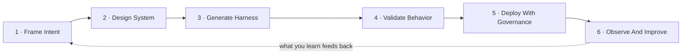

# ADLC Skills · ProductCamp RTP 2026

**Shape, secure, and ship AI agents, with humans at the helm.**

You saw Kevin get hired to summarize feedback, promoted one reasonable rung at a time, and turn into a rogue agent. These are the skills that keep your Kevin from becoming that Kevin.

From the ProductCamp RTP 2026 talk *"ADLC: What It Is & What It Ain't: How to Tame AI Agents So You Don't Get Vibe-Fired"* by Dean Peters.

> **New here? [Try Kevin: three skills in ten minutes →](examples/try-it-kevin/TRY-IT.md)**
>
> **Missed a slide? [Get the deck (PDF) →](slides/deanpeters.productcamprtp.adlc-what-it-is-and-is-not.pdf)**

## What you can do with these

Bring an agent idea, or an agent that's already running, and walk away with something you can put in front of your team, your boss, or your next interviewer:

- **Decide whether an agent is worth building at all.** Get a nine-box Agent Strategy Canvas and a straight answer: pivot, punt, or pursue.
- **Give every agent a reason, limits, and an exit.** Write down who it serves, what it may and may never do, and who can stop it, before anyone picks a tool.
- **Catch what demos hide.** Turn "it works in the demo" into evals that test behavior, failure cases, and the product's outcomes, not just Kevin's unit tests.
- **Separate capability from permission.** Set launch gates, oversight, rollback, and authority to stop.
- **Catch constraint decay before you need a governance root canal.** Check a live agent for the five signs: Mission Mush, Context Creep, Promiscuous Permissions, Work Sloppage, and Output Obsession.
- **Ask whether the deal has changed.** When your product moves from growth to maturity, check whether its agent's job should move too.

Every skill works the same way: it builds a named artifact, labels what's fact and what's a guess, and **stops at a human decision**. It never approves anything for you.

## Start from where you are

You don't have to begin at the beginning. Pick the line that sounds like your week.

| If you have… | And you need… | Use |
|---|---|---|
| "Leadership wants us to build an agent" | to know if it's worth it, on one page | [Agent Strategy Canvas](skills/adlc-util-agent-strategy-canvas/SKILL.md) |
| an idea everyone likes | a clear purpose, autonomy level, and stop conditions | [Frame Intent](skills/adlc-step1-frame-intent/SKILL.md) |
| an approved idea | the tools, data, permissions, and boundaries mapped out | [Design Agent System](skills/adlc-step2-design-agent-system/SKILL.md) |
| a design | a bet you can test cheaply before building | [Solution Hypothesis](skills/adlc-util-solution-hypothesis/SKILL.md) |
| a design you're ready to build | a build plan a reviewer can actually inspect | [Generate Agent Harness](skills/adlc-step3-generate-agent-harness/SKILL.md) |
| a few ways to build it | one story per prototype, and a prompt any builder can use | [Minimum Viable Narrative](skills/adlc-util-minimum-viable-narrative/SKILL.md) |
| a working prototype | evals that show whether it's actually ready | [Validate Agent Behavior](skills/adlc-step4-validate-agent-behavior/SKILL.md) |
| passing evals | launch gates, oversight, rollback, and who can stop it | [Deploy With Governance](skills/adlc-step5-deploy-with-governance/SKILL.md) |
| a live agent | to learn from what it's doing: improve, restrict, or retire | [Observe And Improve](skills/adlc-step6-observe-and-improve/SKILL.md) |
| a live agent that's had lots of small changes | a check of the total against what was approved | [Constraint Decay Check](skills/adlc-util-decay-check/SKILL.md) |
| a product whose numbers changed direction | to know whether its agent's job should change too | [Product Lifecycle Check](skills/adlc-util-plc-check/SKILL.md) |

## The loop

Five motions do the steering. You govern at the helm.



It isn't a waterfall. A failed eval can send you back to design. An incident can change the intent. A governance constraint can stop a launch. Each stage leaves you with an artifact you can share and argue with:

| Stage | Skill | You leave with |
|---|---|---|
| 1 | [Frame Intent](skills/adlc-step1-frame-intent/SKILL.md) | **Agent Intent Brief:** whose work changes, why, and within what limits |
| 2 | [Design Agent System](skills/adlc-step2-design-agent-system/SKILL.md) | **Agent System Map:** tools, context, memory, permissions, and control boundaries |
| 3 | [Generate Agent Harness](skills/adlc-step3-generate-agent-harness/SKILL.md) | **Agent Harness Brief:** an inspectable build plan and test surface |
| 4 | [Validate Agent Behavior](skills/adlc-step4-validate-agent-behavior/SKILL.md) | **Validation Pack:** expected behavior, failure probes, and evidence |
| 5 | [Deploy With Governance](skills/adlc-step5-deploy-with-governance/SKILL.md) | **Governed Deployment Plan:** launch gates, oversight, rollback, and stop authority |
| 6 | [Observe And Improve](skills/adlc-step6-observe-and-improve/SKILL.md) | **Observation Review:** continue, change, restrict, or retire |

## Three ways to start a skill

Every skill asks you to pick one:

- **Guided:** when you know the answers but haven't written them down. It asks one question at a time and skips anything you've already told it.
- **Context dump:** when you have the documents. Hand it your brief, notes, or dashboards, and it sorts what's known, assumed, missing, or in conflict, then asks only about the gaps.
- **Best guess:** when you need a first draft to argue with. It drafts everything now and marks every assumption.

## Install

You'll need your own access to the app you choose. Nothing here supplies an account, model, or API key.

### Claude Code

In a Claude Code session, run these one at a time:

```text
/plugin marketplace add deanpeters/ADLC-Skills-ProductCampRTP26
/plugin install adlc@adlc-productcamp-rtp26
```

Start a new session, then call a skill by name, for example:

```text
/adlc:adlc-util-agent-strategy-canvas
```

### Claude Cowork

Download [claude.plugin](plugins/claude.plugin) with GitHub's download button and upload it through Cowork's plugin interface. If the file picker wants a `.zip`, rename your copy to `claude.zip`; it's already a ZIP archive. Start a new session after enabling it.

### Codex

Use a current Codex CLI with the `plugin` commands available. In your **terminal**, run these one at a time (these are not chat slash commands):

```bash
codex plugin marketplace add deanpeters/ADLC-Skills-ProductCampRTP26
codex plugin add adlc@adlc-productcamp-rtp26
codex plugin list --marketplace adlc-productcamp-rtp26 --json
```

The last command should show `adlc@adlc-productcamp-rtp26` under `installed`, with `enabled: true`. Restart Codex and start a new chat, then try:

```text
Use adlc-util-agent-strategy-canvas in Guided mode on my agent idea.
```

If your CLI does not recognize `codex plugin`, update it before using these commands. This installation route fetches the plugin from the repository; you do not need to download [codex.plugin](plugins/codex.plugin) separately. That file is a ZIP package for compatible import or local-plugin workflows, not a universal one-click installer.

See [OpenAI's marketplace documentation](https://developers.openai.com/plugins/build/plugins#add-a-marketplace-from-the-cli) for supported sources and desktop installation options.

Or skip installing: **Code → Download ZIP**, extract it, open the folder as your project, and ask Codex to read and follow `skills/<skill-name>/SKILL.md` and its linked references. This uses the files directly; it does not install the plugin.

### Any chatbot that accepts files

Download the repository and give the chatbot the skill's `SKILL.md`, its `template.md`, and any files it asks for. Then tell it which mode you want: Guided, Context dump, or Best guess.

## Before you use it for real

- **Practice with fiction first.** Every example here is synthetic and invented for teaching. Keep customer records, credentials, and anything confidential out of practice sessions.
- **You decide.** The skills structure the thinking. They don't approve an agent, grant access, or certify that anything is ready. Review what they give you before you act on it.
- **These are teaching materials, not software.** They have structural checks and worked examples, not real-world usability testing.
- **ADLC isn't a settled standard, and nobody owns it.** This is one practical approach. Other organizations use the term differently.

## Where the ideas come from

The [glossary](reference/glossary.md) explains every term in plain language. The [findings](findings/adlc-working-model.md) summarize the published guidance behind each skill, and the [bibliography](findings/bibliography.md) credits the original sources. Linked third-party works keep their own rights and terms.

## License

Credit: Dean Peters and Productside. Licensed under [CC BY-NC-SA 4.0](LICENSE). You can share and adapt it if you give credit, keep it non-commercial, note your changes, and share your adaptations under the same license. This license doesn't grant rights to third-party works or trademarks.

Package version **0.6.0** · [what's in the packages](plugins/README.md) · [what changed in this edition](CHANGES.md)
